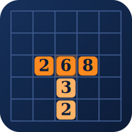

  

<h1 align="center">ČÍSELNÁ ARÉNA</h1>

<strong>Čísla místo slov. Taktika místo náhody.</strong>

  Matematická desková hra, ve které rozhoduje každý tah. 
  Skládej příklady z čísel, obsazuj bonusová pole a přehraj soupeře.

  <a href="https://caseycz.github.io/Ciselna-Arena/"><strong>▶️ HRÁT ZDARMA</strong></a>
  &nbsp;·&nbsp;
  <a href="https://caseycz.github.io/Ciselna-Arena/how-to-play.html">📖 JAK HRÁT</a>
  &nbsp;·&nbsp;
  <a href="https://caseycz.github.io/Ciselna-Arena/leaderboard.html">🏆 ŽEBŘÍČEK</a>

✨ Bez instalace &nbsp;·&nbsp; 📱 Na mobilu i počítači &nbsp;·&nbsp; 🧠 Pro malé i velké stratégy

---

## 🧩 Jednoduchá pravidla. Spousta možností.

Představ si klasickou slovní deskovou hru — jen místo písmen pokládáš **číslice**. A místo slov vytváříš **správné matematické příklady**.

**Na desku položíš:** `2 · 6 · 8`  
**Hra rozpozná:** **2 + 6 = 8** ✅

Znaménka ani rovnítko pokládat nemusíš. Číselná aréna příklady pozná sama.

Můžeš skládat také příklady s odčítáním, násobením, dělením, mocninami a odmocninami. Správným napojením na čísla soupeře dokážeš jedním tahem získat pořádnou porci bodů!

## 🎮 Vyber si svůj souboj

| Herní režim | Co tě čeká |
| :--- | :--- |
| 🤖 **Proti počítači** | Zahraj si kdykoliv. Čekají tě tři obtížnosti: Začátečník, Pokročilý a Expert. |
| 👥 **Dva hráči** | Vyzvi někoho vedle sebe a střídejte se na jednom zařízení. |
| ⚔️ **Náhodný soupeř** | Nech si najít protihráče online a poměřte své síly. |
| 💌 **Hrát s přítelem** | Přidej si přátele, pošli výzvu a zahrajte si soukromou partii. |

Hru proti počítači i ve dvou na jednom zařízení spustíš **bez přihlášení**. Pro online souboje se přihlásíš přes Google.

## 🎯 Jak získat vítězství?

1. **Polož první příklad přes střed** desky o velikosti 15 × 15 polí.
2. **Navazuj na položená čísla** a vytvářej další platné příklady.
3. **Využívej bonusová políčka**, která znásobí získané body.
4. **Přemýšlej dopředu** — nejvyšší skóre na konci partie vyhrává!

V jednom tahu můžeš přidat až **pět číslic**. Když se ti nehodí, můžeš je vyměnit nebo tah vynechat.

👉 [**Nauč se hrát na interaktivním příkladu**](https://caseycz.github.io/Ciselna-Arena/how-to-play.html)

## ✨ Co všechno v aréně najdeš?

- 🟦 **Bonusová políčka** a chytré bodování.
- 💡 **Nápovědu** při hraní proti počítači.
- ⏱️ **Čas na tah podle tebe** v místní hře; online má každý tah 60 sekund. Zvuky lze zapnout nebo vypnout v obou režimech.
- 🎬 **Přehledné vyhodnocení tahů**, příkladů a bodů.
- 🔄 **Pokračování v rozehrané partii** a možnost odvety.
- 🏅 **Hráčské profily, statistiky a žebříček**.
- 💬 **Přátele, výzvy a chat** v online hře.

*Online hraní se stále ladí, takže se občas může objevit drobný zádrhel.*

---

## 🏆 Máš na to stát se šampionem?

Každé číslo může změnit průběh partie. Někdy stačí jednoduchý příklad, jindy rozhodne dokonale načasovaný tah přes bonusové pole.

  <a href="https://caseycz.github.io/Ciselna-Arena/"><strong>🎮 VSTOUPIT DO ČÍSELNÉ ARÉNY</strong></a>

  <a href="https://caseycz.github.io/Ciselna-Arena/leaderboard.html">🏆 Podívat se na žebříček</a>
  &nbsp;·&nbsp;
  <a href="https://caseycz.github.io/Ciselna-Arena/how-to-play.html">📖 Prohlédnout si pravidla</a>

---

### 💬 Máš nápad, jak hru vylepšit?

[**Napiš nám svůj nápad nebo upozorni na chybu.**](https://github.com/CaseyCZ/Ciselna-Arena/issues) Každá zpětná vazba pomůže Číselnou arénu posunout dál.

Číselná aréna je nezávislý projekt. Není propojena s autory ani provozovateli původní hry. Práva k původním prvkům náleží jejich vlastníkům.
